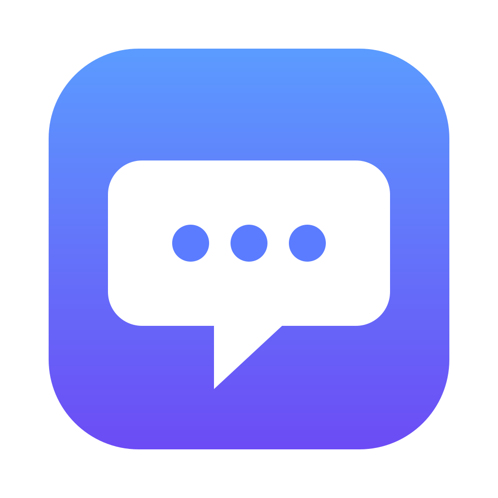

<p align="center"></p>

# forge-hello-world

The app is called **hello-forge** (`hello` is too generic and may clash with other programs). The window title "Hello, forge" and this repository's name stay.

The smallest [forge](https://github.com/camaleaun/forge) app: a label, a button and a command, written as a tiny web app.

- `package.json`: app name and version.
- `App.tsx`: the two screens in `<steps>` and the CLI command (`--greet`).
- `screens/Language.tsx` and `screens/Language.css`: screen 1, a 420x180 language dialog like the first one of a classic installer: a prompt, the language dropdown, the language-download progress bar (`<progress source="language-download" />`), and **OK** (the default button, Enter; disabled while a language pack downloads) and **Cancel** (Escape) at the bottom right.
- `screens/Hello.tsx` and `screens/Hello.css`: screen 2, 600x440: the greeting (`state`, a handler), the per-target `<only macos>`/`<only linux>` shortcut hint, a thin divider, and a footer with **Back** and **Greet** (the default button) together and **Close** apart.
- `App.css`: what is shared: the window size of the first screen, 85x24 push buttons and an `@media (min-width: 480px)` rule; no colors, so dark mode works. Each screen keeps its own numbers (margins, gaps) in its own CSS file, with class names that differ because CSS is global.
- `icon.svg`: the app icon (forge turns it into `AppIcon.icns`).

```tsx
const message = state(__('Press the button'));
export function greet() { message.set(__('Hello, world!')); }
```

Choosing a language and pressing OK shows the second screen: the window changes size (it is not resizable). Back returns to the language dialog.

The same app written by hand is in [`native/macos`](native/macos) (Swift + AppKit) and [`native/linux`](native/linux) (C++ + GTK 4) so you can compare the code, the size and what forge adds.

## Try it
With a forge checkout next to this repository (`../forge`, or set `FORGE_HOME`):

```sh
../forge/bin/forge start                      # live preview in the browser (open the URL it prints on your phone; add --local to keep it on this Mac)
../forge/bin/forge build --out build/src      # generate the native sources
cmake -S build/src -B build/out && cmake --build build/out
build/out/hello-forge.app/Contents/MacOS/hello-forge --greet   # Hello, world!
open build/out/hello-forge.app                       # the window
```

On Linux add `--target linux` to `forge build` and run `build/out/hello-forge`.

The macOS binary is about 131 KB (131,224 bytes in CI) and the Linux one 96,968 bytes on x86_64 and 92,608 bytes on arm64 (CI), all with the language support. 0.4.0 turns the app into two screens (a language dialog, then the greeting) with default and cancel buttons, which cost only 368 bytes on macOS, 96 on Linux x86_64 and 64 on arm64 over 0.3.0 (the generated code has no navigation unless the app uses it). Add `-DFORGE_UNIVERSAL=ON` to the configure step for an arm64 + x86_64 macOS build.
`.forge-ref` pins the forge commit that CI and releases use.

## Install on Linux
Each release has packages for x86_64 and arm64 (`<arch>` is `x86_64` or `arm64`):

```sh
sudo apt install ./hello-forge-<version>-linux-<arch>.deb                  # Debian, Ubuntu
sudo dnf install ./hello-forge-<version>-linux-<arch>.rpm                  # Fedora, RHEL
sudo snap install --dangerous ./hello-forge-<version>-linux-<arch>.snap    # snap (not from the store, so --dangerous)
tar xzf hello-forge-<version>-linux-<arch>.tar.gz                          # any distribution; run the binary inside
chmod +x hello-forge-<version>-linux-<arch>.AppImage && ./hello-forge-<version>-linux-<arch>.AppImage
./hello-forge-<version>-linux-<arch>.AppImage --appimage-extract-and-run   # when FUSE is not installed
```

Requirements:
- GTK 4 (`libgtk-4-1` on Debian and Ubuntu).
- The packages are built on ubuntu-24.04, so they need glibc >= 2.39 (Ubuntu 24.04 or newer, Debian 13, Fedora 40 or newer).
- For the language download: libsoup 3 (`libsoup-3.0-0`) and glib-networking (TLS for https). Without them the app still works, in English.

## Where the app keeps its settings
| | Settings (language, download on/off) | Downloaded language packs |
|---|---|---|
| Linux | `~/.config/local.forge.hello_forge/settings.ini` | `~/.cache/local.forge.hello_forge/lang` |
| macOS | `~/Library/Preferences/local.forge.hello-forge.plist` | `~/Library/Application Support/local.forge.hello-forge/lang` |

Delete them to start from English again. On Linux `XDG_CONFIG_HOME` and `XDG_CACHE_HOME` move the two folders.

## Migrating from `hello` (0.2.0-rc.1)
Version 0.2.0-rc.2 renames the app. `hello-forge.app` is a different app from `hello.app`: it has another bundle id (`local.forge.hello-forge`), so the remembered language and the language-pack cache start empty. Delete the old `hello.app` when you no longer need it. The release `v0.2.0-rc.1` keeps its `hello-*` files.

## Languages

The app is written in English and has one translation, `languages/pt-BR.lang` (one `English<TAB>translation` per line). The window has a language dropdown; the choice is remembered. The app itself carries only English: each release also publishes the language pack (`hello-forge-<version>-pt-BR.lang`) and the app downloads the one it needs on first use, then keeps it in its cache. Offline, it stays in English.

To turn downloads off, set `"forge": { "i18n": { "download": false } }` in `package.json`. The command line takes `--locale pt-BR` (cache only, no network).

## Language variants

Every release has two sets of packages. The default ones are English and detect the system language, downloading the pack on first use (as above). The **pt-BR variant** has the Portuguese pack built into the app: it opens in Portuguese on the first launch, offline, with no download, and the language dropdown still lets you switch to English. A variant ignores the system language (and `LANG`, `LC_ALL` and `LC_MESSAGES` for the command line): the order is `FORGE_LOCALE_PREFERENCE`, then your choice in the dropdown, then pt-BR; on the command line `--locale`, then `FORGE_LOCALE`, then your choice, then pt-BR.

The variant files have `-pt-BR` before the extension, and the app is the same app (same name, same app id, same settings):

```text
hello-forge-<version>-darwin-arm64-pt-BR.dmg   hello-forge-<version>-darwin-arm64-pt-BR.zip
hello-forge-<version>-linux-<arch>-pt-BR.deb   .rpm   .snap   .AppImage   .tar.gz
```

```sh
hello-forge --greet                  # Olá, mundo!   (pt-BR variant; the default package prints Hello, world!)
hello-forge --locale en --greet      # Hello, world!
```

`latest.json` lists the default files under `platforms` and `packages` exactly as before, and the variant files under a new `variants` key: `variants["pt-BR"]["darwin-arm64"].dmg`, `variants["pt-BR"]["linux-x86_64"].deb`, and so on (`dmg`, `zip`, `deb`, `rpm`, `snap`, `appimage`, `tar.gz`). The release workflow builds 3 platforms x {default, pt-BR}; artifacts are named `dist-<platform>` and `dist-macos-pt-BR`-style (`dist-<platform>-pt-BR`). Because every pack is inside the variant, it has no HTTP client at all (no libsoup on Linux, no `NSURLSession` on macOS): in the 0.4.0-rc.3 dry run the binary is 128,368 bytes against 149,088 on macOS (14% less), 76,488 against 113,352 on Linux x86_64 (33% less) and 76,216 against 109,016 on arm64 (30% less).

To build one yourself: `forge build --out build/src --bundle-locale pt-BR` and `cmake -S build/src -B build/out -DFORGE_VARIANT=pt-BR`.

## macOS signing and notarization
Without secrets, releases are signed ad-hoc and not notarized: on first launch macOS may refuse to open the app
(System Settings > Privacy & Security > "Open Anyway", or `xattr -dr com.apple.quarantine /Applications/hello-forge.app`).

To ship signed and notarized builds, add these repository secrets (Settings > Secrets and variables > Actions).
The release workflow uses them automatically through `forge/scripts/macos-sign.sh`; nothing else changes.

| Secret | What it is |
|---|---|
| `MACOS_CERTIFICATE_P12` | base64 of your "Developer ID Application" certificate exported as `.p12` (`base64 -i cert.p12 \| pbcopy`) |
| `MACOS_CERTIFICATE_PASSWORD` | the password you set when exporting the `.p12` |
| `MACOS_SIGNING_IDENTITY` | e.g. `Developer ID Application: Your Name (TEAMID)` |
| `NOTARY_KEY_P8` | base64 of the App Store Connect API key (`AuthKey_XXXX.p8`) |
| `NOTARY_KEY_ID` | the API key id |
| `NOTARY_ISSUER_ID` | the API issuer id |

It needs a paid Apple Developer account. The app and the `.dmg` are signed with the hardened runtime, submitted to `notarytool` and stapled.

## Tests
`npm test` runs the acceptance test (needs cmake, a forge checkout, and macOS or Linux with GTK 4 and libsoup 3), checks the native versions and the READMEs, and lints the workflows. The native Linux build test runs only on Linux with g++ and `libgtk-4-dev`; elsewhere it is skipped.

## License
MIT
